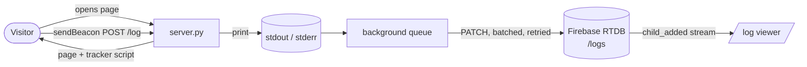

<div align="center">

# 🐦 huff_page

**A tiny Bengali "bird's nest" page with a live visitor tracker, and every server log mirrored to Firebase in realtime.**


[Quick start](#-quick-start) · [Live log](#-live-log) · [Deploy](#-deploy-on-render) · [How it works](#-how-it-works) · [FAQ](#-faq)

</div>

---

## ✨ What it does

| | |
|---|---|
| 🐦 **The page** | `pakhir-basha.html` is a one-screen scene (পাখির বাসা) with a bird, a **হুঁহ!** button and an anger meter that cycles through four moods. |
| 📡 **The tracker** | `server.py` injects a small script into the page. It reports the device model, every button press, the mood shown and when a visitor leaves or comes back. |
| ☁️ **Firebase mirror** | Every line the server prints, including errors and tracebacks, is also written to Firebase Realtime Database. |
| 🔴 **Live log viewer** | Open **`/log`** to watch the logs stream in. No refresh and no Render dashboard. |

> [!NOTE]
> The server uses the Python standard library only. There is nothing to `pip install`.

## 🚀 Quick start

```bash
git clone <your-repo-url> huff_page
cd huff_page
python3 server.py
```

Then open:

| URL | What you get |
|---|---|
| `http://localhost:8000/` | The page |
| `http://localhost:8000/log` | The live log viewer |

<details>
<summary><b>📱 Testing on a phone (HTTPS needed for the device model)</b></summary>

Browsers only expose the device model (`navigator.userAgentData`) on **HTTPS**. Use a tunnel:

```bash
cloudflared tunnel --url http://localhost:8000
# or
ngrok http 8000
```

On desktop, or in browsers other than Chromium on Android, the model is reported as unavailable. The log says which case it was.

</details>

## 🔴 Live log

`log.html` is served at **`/log`** (also `/log.html`). It connects straight to Firebase, so new lines appear the moment the server writes them.

- 🟢 **Status light** shows live or reconnecting
- 🔍 **Filter box** narrows the view as you type
- ⏬ **Follow** keeps you on the newest line, and turns off if you scroll up
- ⏸️ **Pause / resume** freezes the view while lines keep arriving in the background
- 🧹 **Clear view** clears your screen only; the database is untouched
- 💾 **Download** saves the visible lines as a `.txt` file
- 🔴 Lines from `stderr` are shown in red

> [!TIP]
> You can also read the raw logs in the Firebase console under **Realtime Database → `/logs`**.

## 🧠 How it works



1. `server.py` wraps `stdout` and `stderr`, so each line still goes to the console and is also queued.
2. A background thread sends the queue to Firebase in order, in batches of up to 200 lines.
3. **If a send fails, the batch is retried** with backoff until it succeeds, so a network blip doesn't drop lines.
4. On `SIGTERM` (how Render stops a service) and on Ctrl+C, the queue is flushed before the process exits.
5. `/log` subscribes to the newest 1000 lines, then streams new ones as they arrive.

### 🧾 Log entry shape

Each entry lives at `/logs/<key>`. The key is a zero-padded timestamp plus a counter, so entries sort in time order.

```json
{
  "1794581395655_000008": {
    "t": 1794581395655,
    "s": "out",
    "m": "[14:49:55] NEW VISIT   #abc123   model: Pixel 8"
  }
}
```

| Field | Meaning |
|---|---|
| `t` | Time in epoch milliseconds |
| `s` | `out` for stdout, `err` for stderr |
| `m` | The log line, truncated at 8000 characters |

### 👀 What gets logged

| Event | Trigger |
|---|---|
| `PAGE REQUESTED` | Someone loads `/` |
| `NEW VISIT` | The tracker reports in, with the device model |
| `HUFF #n` | A button press, with the anger level and mood, plus how many of the 4 moods the visitor has seen |
| `SEEN EVERYTHING` | A visitor has seen all four moods |
| `LEFT/HIDDEN` / `BACK` | The tab is hidden or becomes visible again |

Moods by anger level:

| Level | Mood |
|---|---|
| below 60 | cooled down |
| 60 to 84 | angry |
| 85 to 99 | very angry |
| 100 | MAX (about to burst) |

## ☁️ Deploy on Render

1. Create a **Web Service** from this repo.
2. Set **Runtime** to `Python`.
3. Set **Build Command** to *(leave empty)*.
4. Set **Start Command** to `python3 server.py`.
5. Deploy.

Render sets `PORT`, and the server then binds to `0.0.0.0` on its own.

## ⚙️ Configuration

| Variable | Default | Purpose |
|---|---|---|
| `PORT` | `8000` | HTTP port. Render sets this automatically. |
| `FIREBASE_DB_URL` | `https://xxxxxxxx-default-rtdb.firebaseio.com` | Realtime Database URL for log mirroring |
| `FIREBASE_LOG_PATH` | `logs` | Path in the database where logs are stored |

CLI flags: `--port`, `--host`, `--page <path-to-html>`.

> [!IMPORTANT]
> If you change the database, also update `DB_URL` near the top of the script in `log.html`. The viewer runs in the browser and can't read environment variables.

## 🗂️ Project layout

```text
huff_page/
├── server.py           # web server, tracker injection, Firebase log mirror
├── pakhir-basha.html   # the page
├── log.html            # live log viewer, served at /log
└── README.md
```

## 🔒 Security

> [!WARNING]
> With rules set to `true`, **anyone with the database URL can read, overwrite or delete your logs**, and the logs contain visitor info such as device models. That's fine for development. Lock it down before you rely on it.

A simple hardening path:

```json
{
  "rules": {
    "logs": {
      ".read": false,
      ".write": false
    }
  }
}
```

That blocks all client access. The server's REST writes would then need authentication, for example a database secret or a service-account token. The `/log` viewer would need Firebase Auth to read.

## ❓ FAQ

<details>
<summary><b>Why is the device model empty?</b></summary>

Only Chromium on Android exposes it, and only over HTTPS. The log line says whether the cause was a non-secure page or a browser without `userAgentData`.

</details>

<details>
<summary><b>Will old logs ever be deleted?</b></summary>

Not automatically. The database grows until you clear `/logs` in the Firebase console or add a cleanup job.

</details>

<details>
<summary><b>Does "clear view" delete anything?</b></summary>

No. It only clears what's on your screen. Reload to load the latest 1000 lines again.

</details>

<details>
<summary><b>What if Firebase is down?</b></summary>

The server keeps running and queues lines in memory, retrying with backoff. Retry errors are printed to the real console only, so they don't loop back into the mirror.

</details>

## 🛣️ Roadmap

- [x] Mirror all server logs to Firebase in order
- [x] Live `/log` viewer with filter, pause and download
- [x] Flush the queue on shutdown
- [ ] Auto-delete logs older than N days
- [ ] Authenticated `/log` access
- [ ] Per-visitor view in the log viewer

---

<div align="center">

Made with 🐦 and too much anger.

</div>
